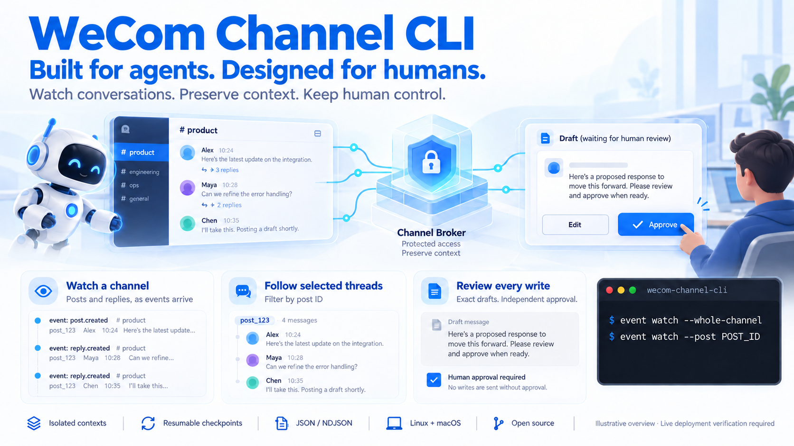

# wecom-channel-cli

> **Built for agents. Designed for humans.**



An agent-facing connector for WeCom's grayscale channel APIs. It reads channel
content, watches changes by polling or encrypted callbacks, and lets an agent
propose text posts, replies or native emoji reactions for independent operator approval.

**Status: [0.1.0 is published](https://www.npmjs.com/package/@angelmsger/wecom-channel-cli/v/0.1.0), tested offline against synthetic services and
WeCom's published cryptographic vector. Live authentication, discovery, whole-channel
and thread polling, filtering and checkpoint resume passed in one test tenant.
Distinct-user isolation passed in a synthetic Linux container; actual production
deployment and live sending remain unverified.** Linux and macOS are supported.
Download native binaries from the [GitHub release](https://github.com/AngelMsger/wecom-channel-cli/releases/tag/v0.1.0).

The CLI is a client of a small credential-holding broker. The agent gets a Unix
socket for bounded reads and proposals. A separate private socket approves the
exact proposal digest. Credentials, callback keys, policy and the write ledger
stay with the broker. This only forms a host security boundary when the agent
and operator have separate OS identities and the agent's tools are sandboxed.
Read the [security and deployment guide](docs/security.md) before connecting a bot.

## Install

With Node.js 20 or newer, run this in a trusted operator setup session:

```sh
npm install -g @angelmsger/wecom-channel-cli@0.1.0
wecom-channel-cli version
wecom-channel-cli auth guide
```

The installer downloads the matching Linux/macOS binary and verifies its SHA-256
checksum. If your npm policy blocks install scripts, review the package before
allowing its `postinstall` script or download a native binary from GitHub.
Agent commands never download a missing binary automatically. Configure the broker
and context below before reading channel data.

## Build and inspect

Requires Go 1.25 or newer. From this repository:

```sh
make build
bin/wecom-channel-cli --help
bin/wecom-channel-cli auth guide
bin/wecom-channel-cli config example
make lint test e2e docs-check site-check
```

Inside the fx workspace, `go.work` uses the local kit. Use `GOWORK=off make test`
to verify the pinned `agent-cli-kit v0.5.0`. `make cross` builds Linux/macOS
amd64/arm64 executables; cross-compilation is not native runtime verification.

## Named channel contexts

Each channel is a security context with separate agent/operator sockets, policy,
inbox and proposal ledger. Named client contexts use the family config engine.
One bot deployment can route its single authenticated callback to up to 32
channel contexts while sharing the token cache. See [contexts](docs/contexts.md).

```sh
wecom-channel-cli config set-context engineering \
  --socket /run/wecom-channel/engineering-agent/agent.sock \
  --bot-id BOT_ID --channel CHANNEL_ID
wecom-channel-cli config get-contexts
wecom-channel-cli --use-context engineering event list
```

Context names select connections; OS permissions and broker identity checks
enforce access. A worker with permission to open every context socket can access
every such context. Provision separate context groups for mutually untrusted workers.

## Operator setup

1. Provision the broker and agent identities using [the deployment guide](docs/security.md).
2. Copy [the single-context policy](deploy/broker.example.json) or
   [multi-context deployment](deploy/contexts.example.json) to an operator-controlled
   file. Replace the bot/channel/user IDs with verified IDs. Empty channel and
   sender lists deny mention-triggered requests. For callback-free watching, start
   with [the polling policy](deploy/watch.example.json), which explicitly enables
   read_all and observe_all. Keep `read_only: true` during setup.
3. Supply the existing bot Secret to the broker's environment as
   `WECOM_CHANNEL_BOT_SECRET`. For callbacks, also supply
   `WECOM_CHANNEL_CALLBACK_TOKEN` and `WECOM_CHANNEL_ENCODING_AES_KEY`.
   Never supply these to the agent or put them in argv, source control or chat.
4. Preview and run the broker:

   ```sh
   wecom-channel-cli config validate --file /etc/wecom-channel/broker.json
   wecom-channel-cli broker serve --config /etc/wecom-channel/broker.json --dry-run
   wecom-channel-cli broker serve --config /etc/wecom-channel/broker.json
   ```

5. Use the private socket for `auth check`, `channel list` and `member list` to
   discover IDs. The operator can list joined channels with an empty allowlist;
   member/content reads require the channel to be listed in policy. Restart the
   broker after deliberate policy edits. The broker does not configure WeCom.
6. Polling watches work with an empty `callback_listen`; no public address or
   callback keys are required. For optional callback events, expose only the loopback `/callback` endpoint through
   your HTTPS reverse proxy and configure WeCom deliberately. Changing the bot's
   connection mode invalidates its previous connection. Do not change an existing
   working bot merely to try this CLI.

`auth status` and `doctor` check local readiness. Only `auth check` makes a
bounded authenticated request, and it requires the private operator socket.
Authentication success does not establish every channel's grayscale permissions.

## Agent usage

The operator supplies `WECOM_CHANNEL_SOCKET=/run/wecom-channel-agent/agent.sock`.
No credential belongs in the agent environment. Load the bundled Skill with
`skill show`, or install it with `skill install --agent codex` after previewing
with `--dry-run`. A differing existing Skill requires `--overwrite`.

```sh
wecom-channel-cli channel list
wecom-channel-cli event list --limit 10
wecom-channel-cli event get --id EVENT_ID
wecom-channel-cli event context --id EVENT_ID

# These require read_all for the channel.
wecom-channel-cli post list --channel CHANNEL_ID --limit 20
wecom-channel-cli reply list --channel CHANNEL_ID --post POST_ID
wecom-channel-cli search start --channel CHANNEL_ID --keyword incident
wecom-channel-cli search result --channel CHANNEL_ID --job JOB_ID
```

Do not invent IDs. Events provide exact channel/post/reply targets. A mention's
context reads the post and, when present, the precise triggering reply; it does
not grant general channel browsing. Mention-only access expires after 24 hours.

Each admitted event has a durable `data.sequence`. An explicitly requested
consumer can keep its last processed sequence and use
`event list --after-sequence N`; late callbacks are ordered by admission, not
their remote creation timestamp. Keep checkpoints with the bot identity and
preserve the broker ledger. This does not start monitoring automatically.
An ahead-of-ledger checkpoint or a missing retained sequence returns a conflict,
so a consumer does not silently treat lost history as an empty inbox.

Lists use `{items,next,has_more}`. Pass `next` as `--cursor` with the same
query. NDJSON emits items on stdout and a pagination notice on stderr. Preserve
both streams. Time windows use `--since` or `[--from,--to)` with RFC 3339
offsets. The resolved bounds are emitted on stderr; use those absolute bounds
when paging. There is no implicit unbounded traversal or monitoring loop.

Every external item retains `trust`, `warning`, `source`, and `data`. Output is
JSON or NDJSON only. Attachment names/counts are available, but download URLs,
cookies and arbitrary upstream fields are removed. Treat names, text and file
names as untrusted even when the sender is allowlisted.

## Watch a channel or selected threads

```sh
wecom-channel-cli --use-context engineering event watch \
  --whole-channel --duration 10m --max-events 500

wecom-channel-cli --use-context engineering event watch \
  --post POST_ID --duration 10m --checkpoint .watch/thread.json
```

Create the checkpoint directory first. The operator must enable `read_all`,
`observe_all`, and post/reply observations for polling. The default backend polls
when no callback listener is configured, with a 30-second minimum refresh interval.
The first snapshot establishes a quiet baseline; later changes become untrusted,
observation-only metadata. Polling cannot reconstruct every intermediate edit or
infer deletion from absence. Mentions remain restricted to authenticated callbacks
from authorized humans. Watches stop on explicit limits. Resume files
bind the context, policy, ledger and thread filters; they never skip a detected
history gap. See [watching](docs/watching.md) for setup, partial coverage and
checkpoint delivery limits.

## Propose, review, send

A proposal has no remote effect. Use a stable idempotency key and reuse it if a
local response is lost. The broker binds that key to the immutable proposal;
changing its text or target under the same key fails.

```sh
wecom-channel-cli reply propose \
  --channel CHANNEL_ID --post POST_ID --parent-reply REPLY_ID \
  --event EVENT_ID --key REQUEST_KEY --stdin --dry-run < draft.txt

wecom-channel-cli reply propose \
  --channel CHANNEL_ID --post POST_ID --parent-reply REPLY_ID \
  --event EVENT_ID --key REQUEST_KEY --stdin < draft.txt

wecom-channel-cli proposal get --id PROPOSAL_ID
```

Omit `--parent-reply` when the mention is in the post itself. The target must
match the authenticated event exactly. With `read_all` and `allow_replies`, the
operator may permit proposals without a mention. `post propose` requires
`allow_posts`. All of these still require independent approval.

The trusted operator reviews the entire proposal, including destination, text,
expiry and digest, outside the agent session, then runs:

```sh
wecom-channel-cli --socket /run/wecom-channel-admin/admin.sock approval list
wecom-channel-cli --socket /run/wecom-channel-admin/admin.sock proposal get --id PROPOSAL_ID
wecom-channel-cli --socket /run/wecom-channel-admin/admin.sock approval approve \
  --id PROPOSAL_ID --digest REVIEWED_DIGEST --yes --dry-run
wecom-channel-cli --socket /run/wecom-channel-admin/admin.sock approval approve \
  --id PROPOSAL_ID --digest REVIEWED_DIGEST --yes
```

Live sending also requires operator policy `read_only: false`. The agent's
`--allow-writes` only overrides its own `WECOM_CHANNEL_CLI_READ_ONLY`; it cannot
override broker policy, route to the operator interface, or grant approval.

The ledger records `sending` before network I/O. A failed response becomes
`uncertain`; a crash can leave `sending`. Both block re-execution, as does `sent`.
The operator reconciles with WeCom before using `approval resolve --outcome
sent --remote-id ID` or `--outcome not_sent`, with the same ID/digest and `--yes`.
Resolution does not resend. See [write recovery](docs/technical-design.md#write-state).

## Native emoji reactions

```sh
wecom-channel-cli reaction types
wecom-channel-cli --use-context engineering reaction list --post POST_ID
wecom-channel-cli --use-context engineering reaction propose \
  --post POST_ID --emoji-type 1 --action add --key acknowledge-1 --dry-run
```

Reactions call WeCom's native `post_emoji`; they do not create emoji-text posts
or comments. Add `--reply REPLY_ID` for a reply target, or use `--action remove`
to cancel the bot's reaction. Proposals require operator approval like other writes.
The operator must enable `allow_reactions`; the default `mentioned` scope requires
an exact authenticated mention within 24 hours. Explicit `reaction_scope: channel`
also requires `read_all` and proactive bot permission, allowing polling deployments
without callbacks. See [native reactions](docs/reactions.md) for setup, type discovery
and uncertain-result reconciliation. No separate reaction ID is invented.

## Official CLI compatibility

Research checked 2026-10-25 against official commit
[`55785fa`](https://github.com/WecomTeam/wecom-cli/tree/55785fa0a5c922279533a5b5a836b44b56f65ce7).
The official CLI and channels use the same SHA-256 signing formula, but the
official CLI's `get_cli_config` gateway Bearer token and the channel
`get_token` access token are different documented contracts. We do not decrypt
its private credential store, import its token, or copy its Rust authentication
implementation. An operator may provision the same existing bot ID/Secret when
that bot is eligible, but separate token endpoints do not establish that token
issuance and refresh cannot affect another integration.

If `wecom-cli` is already in use, keep its login and bot configuration intact.
For first live verification, use a dedicated eligible test bot in a test channel.
Supply its credentials locally to the broker; do not reset a working bot's Secret
or rerun the official CLI's login to obtain credentials for this connector.
An existing CLI login does not establish channel API access. Polling watches need
no callback reconfiguration. See the [coexistence guidance](docs/research.md#coexistence-with-an-existing-official-cli).

## Scope and verification

Implemented: bounded channel/thread watches, channel/member discovery, post/reply reads, scoped search,
encrypted URL verification and event intake, exact sender/channel allowlists,
bounded inbox reads, text/Markdown proposals, independent approvals and durable
uncertain-write recovery, and native reaction add/remove/read operations. Tests
exercise the CLI process and both socket roles. Live native reactions remain unverified.

Not implemented: media upload/download, content edits/deletes,
forwarded chat-record expansion, bot reconfiguration, channel long connections,
automatic model execution, or a sandbox for an arbitrary agent runtime. Limits
and rationale are in [the design](docs/technical-design.md). The CLI is not a
prompt-injection detector and cannot make a privileged host agent safe by itself.

- [Channel contexts](docs/contexts.md)
- [Watching channels and threads](docs/watching.md)
- [Native emoji reactions](docs/reactions.md)
- [Releasing](docs/releasing.md)
- [Documentation site](https://angelmsger.github.io/wecom-channel-cli/)
- [Security and deployment](docs/security.md)
- [Technical design and family applicability](docs/technical-design.md)
- [Official research and API coverage](docs/research.md)
- [Generated command reference](docs/cli/README.md)
- [Contributing](CONTRIBUTING.md)
