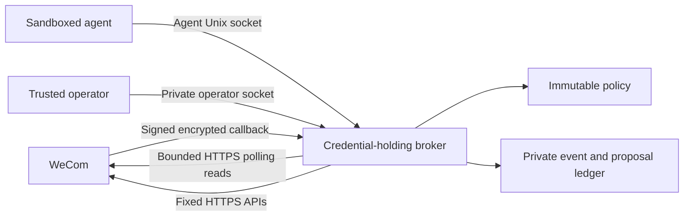

# Technical design

Scope: one new connector repository. No existing CLI or kit behavior is changed.
The initial deliverable is a bounded broker-backed CLI, not an agent runtime.

## Components



`cmd` contains the executable and documentation generator. `internal/app` owns
Cobra, output and local socket requests. `internal/config` loads strict operator
policy; `internal/broker` enforces that policy and owns the HTTP/Unix listeners;
`internal/state` provides atomic durable transitions with an exclusive file lock.
`pkg/apiclient` contains typed WeCom reads, curated response models and the
shared write builder. `pkg/callback` implements the documented crypto/event
protocol. `pkg/safejson` rejects duplicate keys, excessive depth, invalid UTF-8
and trailing JSON. Generic output, errors, transport and argv correction come
from `agent-cli-kit`.

The executable itself has no supported arbitrary URL/method flag, external
command hook, media downloader, remote path handler or credential export. The
Go API client is a protocol library, not the OS security boundary: downstream
library users must enforce their own policy. In this CLI, only the broker
constructs that client and holds the Secret.

## Authentication and callbacks

A deployment has one configured bot identity and receives its Secret through an
operator-managed environment. It signs the documented token request with a
cryptographically random nonce and caches the one-day token in memory with a
one-minute expiry margin. Requests are fixed HTTPS POSTs. The transport inherits
neither proxy environment nor redirect handling and performs no POST retries.
Raw upstream `errmsg`, response bodies and URL-bearing network errors are never
used as diagnostics. Known authentication material is redacted from curated
read content if reflected by the service.

Webhook signature verification precedes decryption. AES-256-CBC and SHA-1 are
protocol requirements, not newly chosen cryptographic primitives. Check the
five-minute URL timestamp window, full PKCS#7 padding, payload length and empty
receive ID. Require the decrypted bot identity to match configuration. Use the
bot identity plus `msgid` to derive the durable event ID. Only supported event types and the configured channel reach the inbox. Human
mentions require exact sender IDs. Explicit observe_all policy additionally admits
post/reply observation records from any human or bot without granting request authority. Callback
processing does no remote read, model invocation or reply.

Events receive a monotonically increasing admission sequence in the same durable
transaction. Inbox pages and `--after-sequence` use it, so a delayed callback
cannot be skipped merely because its remote creation timestamp is older than
the last processed event. Consumers retain their own bot-bound checkpoints;
the broker does not acknowledge, launch, or monitor agent jobs automatically.
Checkpoints ahead of the ledger and missing retained/policy-visible sequences
produce explicit conflicts rather than an apparently complete empty result.

Fresh callback delivery and retained event context are different windows:
callback timestamps have five-minute skew tolerance; event creation times are
at most 24 hours old and at most five minutes in the future; mention reads and
approvals are bounded by the event's 24-hour age. An event retained for audit
does not extend WeCom's permission window.

## Reads and data provenance

The agent can enumerate only its context's single channel. Version 2 deployments
route authenticated callbacks by channel into separate instances of the same
broker logic. Named client contexts add expected context/bot/channel identities
to each request; the listener checks them before dispatch. Client-side selection
never grants server authority. See [context design](contexts.md). The
operator can discover joined channels even with no allowlist, then populate it.
General post/reply/member/search reads require `read_all` for the agent. A valid
mention instead grants only `event context` for that post and exact triggering
reply; it does not grant arbitrary IDs or channel traversal.

Curated models preserve content, identity variants, timestamps, recalled/edited
flags and attachment filenames/counts. They omit download URLs/cookies and
unknown upstream fields. Every external record carries a fixed trust envelope;
no field projection or raw/table mode can remove it. This helps interpretation
but does not replace the host sandbox.

All reads are one page with an explicit limit. NDJSON pagination uses the kit's
stderr notice and actual cursor. A missing pagination contract, non-advancing
cursor, malformed identity or oversized response fails instead of claiming
complete coverage. Filtering a post/reply page to zero records preserves its
upstream continuation. Search uses one allowed channel and exposes the upstream
job ID for its second step.

## Bounded watch delivery

`event watch` follows the family's streaming pattern (Jenkins build-log follow and
OpenObserve search tail): data-only stdout, cancellable requests, and retained
continuation. The channel domain adds an explicit whole-channel/thread scope, a
finite session duration/event count and a broker-bound checkpoint. Confluence's
page watch is a remote subscription, so it is intentionally not reused; the other
four siblings have no equivalent live stream to port. No sibling code changes.

The broker's event.scan scans at most 100 admitted sequences per request, then
filters post IDs and change kinds. The returned sequence advances over skipped
records, while missing/expired/inaccessible sequences fail before delivery.
Checkpoints bind a durable random ledger ID, context/bot/channel, policy and
normalized filters. A reset or rebinding cannot silently reuse a sequence.

The client resolves its socket once, emits NDJSON through the kit, and saves only
successful output progress. Limits are 5m/1000 events by default, up to 24h/100000;
the interval is 1s–1m, default 2s. The total context bounds all requests and waits.
A stalled downstream writer may need a host deadline. State files are private,
atomically replaced and exclusively locked. Output success is not downstream
processing acknowledgment; crash windows can replay records and downstream
processing failures require consumer-owned acknowledgments. See [watching](watching.md).

The checkpoint is local consumer state; broker read-only mode still permits
observation. The CLI's local read-only posture gates checkpoint writes, and
dry-run reads coverage without remote reads, state changes, a checkpoint or lock.
No watch sends messages or launches tools. Polling reads message content inside
the broker for comparison; it persists fingerprints and emits metadata only.

### Polling and callback adapters

The operator selects `auto`, `poll` or `callback`. Auto preserves callback intake
when configured and otherwise selects polling. `event.scan` accepts the same
scope and returns the same inbox contract for either backend. The client honors
the polling interval reported by the broker; its own interval cannot shorten it.
Backend/policy changes invalidate the existing scope-bound checkpoint.

`internal/broker/poll.go` serializes refreshes per context, rate-limits remote
reads and caches scope attempts for the minimum interval. It reads complete,
bounded post/reply snapshots using the existing `apiclient.Client.Read` path.
Whole-channel scopes discover all posts; selected scopes read only their exact
posts. Creation-time pagination cannot serve as a change cursor, so old posts
and replies are revisited. The request and record budgets fail explicitly when
the snapshot is too large. Retained inbox pages can drain without remote I/O.

`internal/state/poll.go` atomically commits scope baselines, resource fingerprints
and derived events in the existing ledger transaction. Overlapping scopes share
fingerprints, including when a new scope observes a resource for an already
initialized scope. Initial snapshots suppress historical records; failed pages,
cursor cycles, capacity errors and cancellation commit nothing. A failed disk
fsync after rename retains the committed in-memory state, as for existing events.

Polling records are observation-only and never become mention authorization.
They identify their transport and inference basis; their change actor is unknown.
A returned recall flag is evidence, but absence is not. Intermediate changes,
reactions and membership events are not reconstructed. No background job runs
without an active watch. See [watching](watching.md) for coverage and limits.

## Write state

```text
proposal -> pending -> sending -> sent
                    \          -> uncertain
                     -> rejected

sending/uncertain -> resolved_sent | resolved_not_sent
```

`sending` also represents a crash after the durable transition. No terminal or
uncertain state can be approved again. There is no automatic retry. Expiry and
policy mismatch prevent pending approval without rewriting historical evidence.

The shared `BuildWrite` validates the exact JSON body for both previews and
execution. A proposal binds bot, operator-policy digest, operation, channel,
post/parent reply, triggering event, exact content and caller idempotency key.

Native reactions share this state machine. `reaction propose` binds an exact
post or reply, numeric native type and explicit add/remove action; `BuildWrite`
maps it to `topic/post_emoji` with no text body. `allow_reactions` is independent
of text permissions. Mention scope requires a matching callback within 24 hours
at proposal and approval time; explicit channel scope requires read_all and the
operator's verified proactive bot access. Poll events cannot supply that authority.

The provider's successful reaction response has no resource ID. `sent` means the
mutation was acknowledged, and remote_id remains absent. For an uncertain
reaction, the operator inspects `reaction list` and resolves the immutable
proposal without --remote-id; the CLI rejects fabricated reaction IDs. Neither
an automatic retry nor an opposite action is a recovery mechanism. Curated
emoji_list metadata is available on content reads; membership is excluded from
poll fingerprints so it does not masquerade as a post/reply change feed.
The SHA-256 digest is also its ID. The digest detects changes; Unix permissions
and listener authority authenticate approval. A reused key with differing
content, target or policy is a conflict.

The operator must read the entire proposal, provide its digest and confirm with
`--yes`. The broker rechecks policy, expiry and event-target binding. It records
`sending` durably before token/network I/O. Concurrency is serialized around
approval, while an exclusive state lock prevents another process using the same
ledger. A returned remote ID is retained on success; a later persistence failure
reports it explicitly. Any request failure is conservatively uncertain, even
when the underlying failure may have occurred before sending. Reconciliation
records evidence; it never resends.

Each context has an event/proposal ledger: a single versioned JSON snapshot with 0600 atomic
replacement, file and directory fsync, a private 0700 state directory and an
exclusive OS lock. It is capped at 64 MiB, with separate event/proposal counts.
Atomic replacement errors after rename retain the committed in-memory state so
subsequent operations cannot replay an ambiguous transition. One deployment shares a trusted process across independently bound channel
contexts. Each ledger is bound to its bot, context and channel. Horizontal replicas
and cross-ledger exactly-once delivery are not claimed.

## Limits

- Agent request: 64 KiB; callback body: 256 KiB; upstream response: 2 MiB;
  local client response: 4 MiB; JSON depth: 32.
- Each local role and callback listener has its own fixed-window request budget
  (default 60/minute), and each handler admits at most eight concurrent requests.
- Upstream timeout: 30 seconds; local request context: 60 seconds; CLI default:
  65 seconds. CLI requests can be bounded further, up to a two-minute maximum.
- Default inbox: 5000 events, 48-hour retention. Default proposal capacity: 1000,
  retained without automatic pruning. Full storage rejects new work.
- Default proposals expire in 3600 seconds. Content is 1–20480 UTF-8 bytes;
  outbound control/bidi characters and unsupported inline placeholders are
  rejected. Files and mentions are not resolved from Markdown.
- Broker read-only defaults to true. Changing it requires operator policy and
  restart; an agent's local session override cannot weaken it.

## Family applicability

All seven maintained siblings were inspected before implementation. The common
reference points were `internal/app/root.go`, `internal/app/skill.go`,
`internal/auth`, `pkg/transport/http.go`, and each available read-only decorator.
WeCom Calendar's local `meta` write gate was checked separately.

| Sibling | Applicable shared pattern | Channel-specific difference / change |
| --- | --- | --- |
| Bitbucket CLI | Kit errors/output/transport, command groups, read-only decorator, dry runs | Existing service CLI; no channel intake or separate operator broker. No changes |
| Confluence CLI | Same shared skeleton and write gates | Existing service CLI; channel broker is outside scope. No changes |
| Jenkins CLI | Kit transport and server-side write decorator | Build operations remain under its existing contract. No changes |
| Jira CLI | Kit errors/config/auth/output and read-only decorator | Issue workflow is not a channel event gateway. No changes |
| OpenObserve CLI | Kit transport/output and read-only client surface | Read-oriented telemetry domain. No changes |
| Prometheus CLI | Kit pagination and guarded admin writes | Metric/admin domain. No changes |
| WeCom Calendar CLI | Kit baseline plus domain-specific private local store | CalDAV identity and calendar-only reads remain separate. No changes |
| Agent CLI Kit | Reuse published v0.5.0 config, errors, output, transport, flags and Skill metadata | No business-product code or new shared abstraction added |

For polling, Jenkins `internal/app/build_log.go` and OpenObserve
`internal/app/search.go` provide the cancellable streaming reference. WeCom
Calendar `internal/sync/sync.go` provides the comparison-before-watermark lesson,
but its server ETags do not exist in the channel API. Confluence page watching
changes a remote subscription and is intentionally different. Bitbucket activity,
Jira worklog history and Prometheus queries remain bounded reads, not a channel
snapshot ledger. Their shared output/transport/time-bound contracts apply; this
product-specific polling implementation requires no sibling changes.

The new broker deliberately strengthens authorization beyond a CLI-local
`--allow-writes`: a separate operator must approve every send. These safeguards
could inform a future family-wide untrusted-content project, but this task does
not silently alter seven existing products. Existing sibling content can also
contain prompt injection; their ordinary direct-CLI model should not be mistaken
for host isolation.

Other deliberate differences:

- Operator-owned strict JSON policy remains separate from named client contexts.
  Client selection, merge planning, atomic YAML persistence and context notices
  use `agent-cli-kit/config`. One context pins a bot/channel/socket; `.env`
  auto-loading is deliberately disabled. No login wizard, client secret store
  or private credential reuse is added. A future operator credential store must
  use the kit rather than introduce a local keychain.
- JSON/NDJSON only, fixed trust envelope, no arbitrary field projection, table,
  verbose URL logging or raw response export.
- No live release-update request from the credential-free agent CLI: the
  deployed agent may have no network. Upgrade
  the binary deliberately, refresh the embedded Skill, then reload the agent.
- Linux/macOS Unix sockets and single-writer state; no Windows or multi-replica
  promise. Deployment isolation is a separately verified operator responsibility.
- The Skill version line is a body metadata comment: the generic Skill validator
  rejects a top-level `version` field, while the kit's existing reader supports
  the same line anywhere in the document. Loaded/installed/embedded checks still
  use the shared implementation, without a custom version parser.

Observed pre-existing documentation drift: parts of the shared construction
guide still describe auth/config as local until extraction, while current
siblings already delegate them to the kit. The workspace agent guide and current
implementations were followed; shared prose was left unchanged within this
single-project scope. Bitbucket also pins an older kit than the other inspected
CLIs and has user-owned edits; those were not changed.

## Validation

`make lint test e2e docs-check` exercises the protocol, policy, state and actual
CLI process. Tests use synthetic credentials, fake HTTP clients and local test
servers; they do not read the OS keychain or contact WeCom. The crypto test uses
the published known-answer vector. Socket tests cover role separation, file
modes and clean shutdown. Process tests exercise JSON/NDJSON pagination,
proposal creation, denied agent approval and one-time operator execution.

Reaction coverage additionally includes native post/reply add/remove wire bodies,
offline type discovery, acknowledgment without IDs, mention-target/expiry checks,
explicit proactive scope, read-only and digest gates, terminal replay refusal,
unknown-write reconciliation and redacted membership reads. The existing shared
write/output patterns apply across the family; no maintained sibling currently
exposes this native WeCom operation, so no sibling API or implementation changes
are needed.

Before release, repeat with `GOWORK=off`, run the race detector and cross-build,
then complete an explicitly authorized live tenant and isolated-worker check.
Generated docs come from the same Cobra tree and can be checked without Git.
